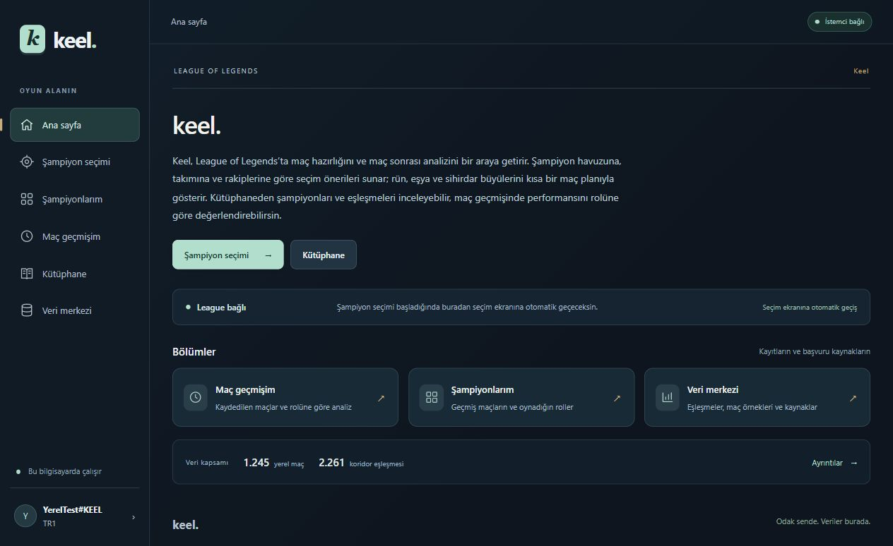

<h1 align="center">keel.</h1>

League of Legends için maç hazırlığı ve maç sonrası değerlendirme.

<a href="https://github.com/kjtasan/keel-lol/releases/latest"><strong>Windows için indir</strong></a> · <a href="https://github.com/kjtasan/keel-lol/releases">Sürüm notları</a> · <a href="https://github.com/kjtasan/keel-lol/issues">Sorun bildir</a>

Keel, şampiyon havuzunu, takımını ve rakiplerini dikkate alarak seçim seçenekleri sunar; rün, eşya ve sihirdar büyülerini kısa bir maç planıyla bir araya getirir. Şampiyon kütüphanesinden eşleşmeleri inceleyebilir, kaydedilen maçlarında skor, görüş ve minyon gelişimini rolüne göre değerlendirebilirsin.

## Şampiyon seçiminde

Takım ve rakip seçimleri geldikçe seçenekler yeniden değerlendirilir. Keel, koridor rakibi netleştiğinde ilgili eşleşmeyi kullanır; rakip belirsizse geniş eşleşme kapsamı bulunan kör seçim adaylarını da değerlendirir. Önerinin gerekçesi ve yeterli verinin bulunmadığı noktalar kartlarda görünür.

## Hazırlık, kütüphane ve maç geçmişi

| Bölüm | Neler bulabilirsin? |
|---|---|
| Maç öncesi hazırlık | Kilitlediğin şampiyon için rün, sihirdar büyüsü, başlangıç eşyaları ve kısa maç planı. |
| Şampiyon kütüphanesi | Yaygın roller, eşya ve rün seçenekleri, takım ikilileri ve rakip eşleşmeleri. |
| Maç geçmişim | Keel açıkken kaydedilen maçlar, son görülen eşyalar, skor gelişimi ve rolüne göre değerlendirme. |
| Sessiz mod | Oyun sırasında bildirim vermeden, maç öncesi hazırlığı ve genel önerileri açıp inceleme. |
| Veri merkezi | Kullanılan kaynaklar, veri kapsamı ve yama yenileme durumu. |

Eşya, rün ve sihirdar büyüsü adlarında oyundaki Türkçe karşılıklar kullanılır. Eşya kütüphanesi Sihirdar Vadisi kapsamına göre süzülür.

*Görseller örnek hesap ve seçimlerle hazırlanmıştır. Öneriler mevcut maç verisine ve seçimlere göre değişir.*

## Kurulum

**Windows 10 (19041 ve sonrası) veya Windows 11 · 64 bit**

1. [Son sürümün](https://github.com/kjtasan/keel-lol/releases/latest) kurulum dosyasını indirip çalıştır.
2. Keel’i aç. League istemcisi açıksa oyun hesabın algılanır; sunucunu seçerek hesabını doğrula.
3. **Hesabım → Riot anahtarı ayarları** bölümünden kendi Riot geliştirici anahtarını ekle. Anahtarı [Riot Developer Portal](https://developer.riotgames.com/) üzerinden alabilirsin. Riot şifren istenmez.
4. Şampiyon havuzunu hazırla. League’de şampiyon seçimi başladığında ana sayfadan seçim ekranına otomatik geçilir.

Python veya komut satırı gerekmez. Görüntüleme bileşeni eksikse kurulum Microsoft WebView2’yi hazırlar; bu işlem için internet bağlantısı gerekir.

## Veriler ve güncellemeler

- Ortak şampiyon, görsel ve eşleşme verileri kurulumla gelir. Kişisel havuzun, maç kayıtların ve Riot anahtarın kendi bilgisayarında tutulur; bu depoya yüklenmez.
- Yeni uygulama sürümleri açılışta kontrol edilir. Güncellemeyi indirmek ve yüklemek senin seçimine bağlıdır. Oyun ve şampiyon seçimi sırasında kurulum başlatılmaz.
- Kurulum ve güncellemeler hesap ayarlarını veya maç geçmişini silmez. Kullanıcı verileri program dosyalarından ayrı saklanır.
- Uygulama sürümü ile oyun verisi ayrı yenilenir. Yama ve eşleşme kaynaklarını **Veri merkezi** üzerinden güncelleyebilirsin.

## İlk sürüm hakkında

Keel geliştirme aşamasındadır. Bu sürümde kişisel maç geçmişini almak için kendi Riot geliştirici anahtarını tanımlaman gerekir. Yeterli kişisel maç bulunmadığında genel verilerden seçenekler sunulur; veri eksikliği arayüzde belirtilir. Öneriler bir kazanma garantisi değildir.

Windows yayıncı sertifikası henüz eklenmemiştir. Dağıtım kaynağı bu deponun **Releases** bölümüdür; güncelleme sistemi sürüm bilgisinin imzasını ve indirilen dosyanın bütünlüğünü kontrol eder.

Bu depo Windows kurulumlarını, sürüm notlarını ve uygulama tanıtımını içerir. Kişisel veriler, ham maç arşivi ve özel yayın anahtarı dağıtıma dahil değildir.

---

Keel, Riot Games tarafından desteklenmez veya onaylanmaz. League of Legends ve ilgili oyun görselleri Riot Games’e aittir.
