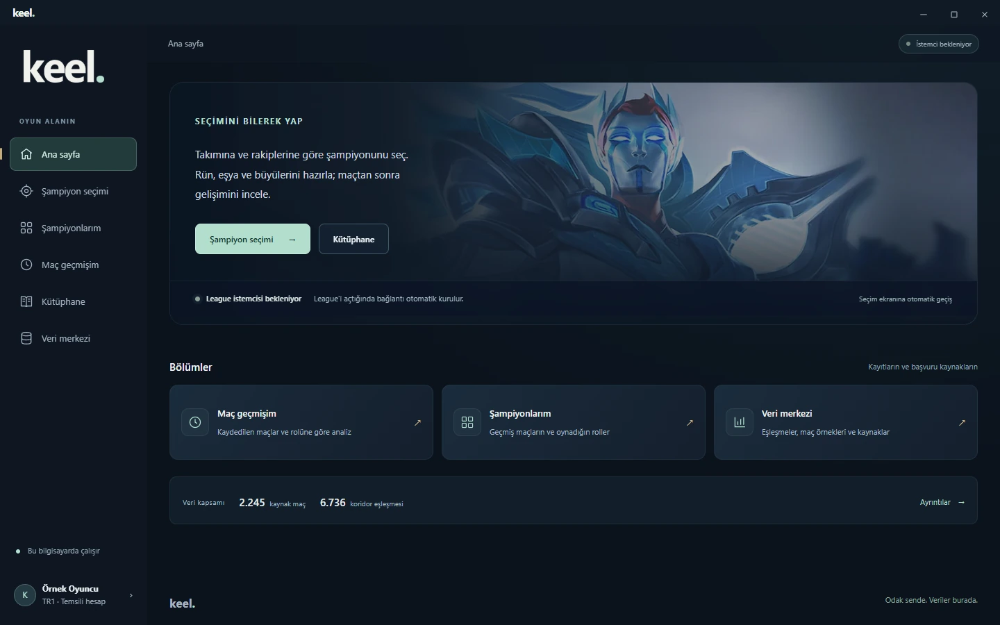
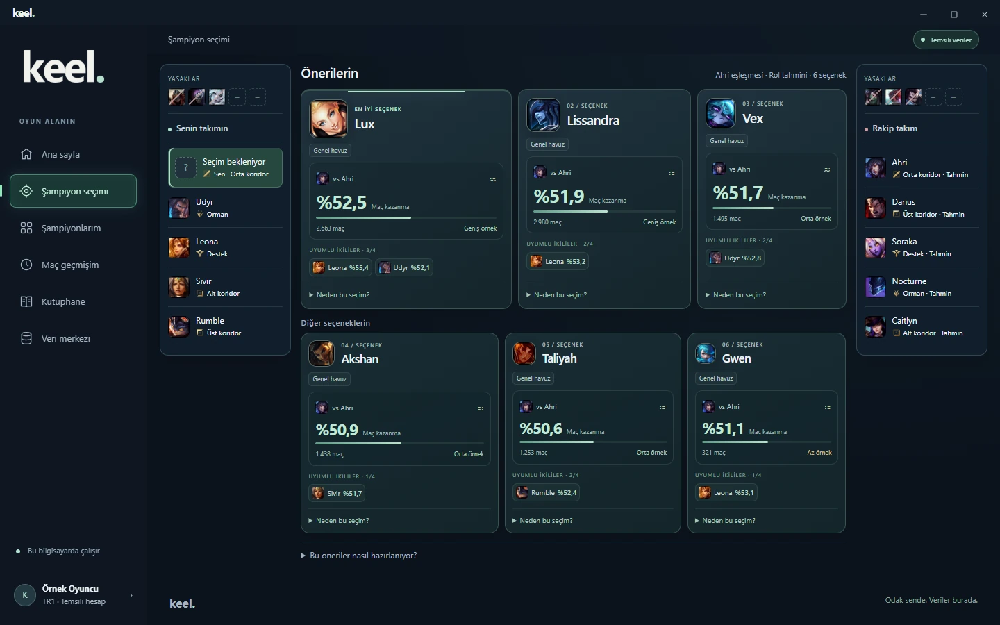
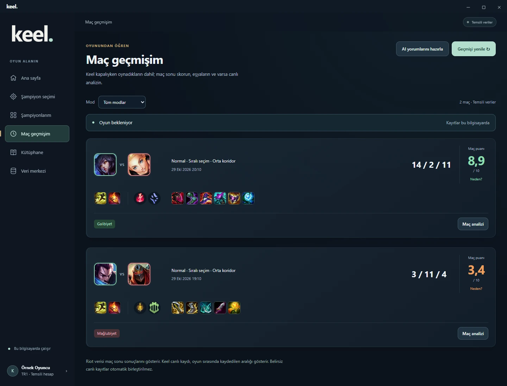
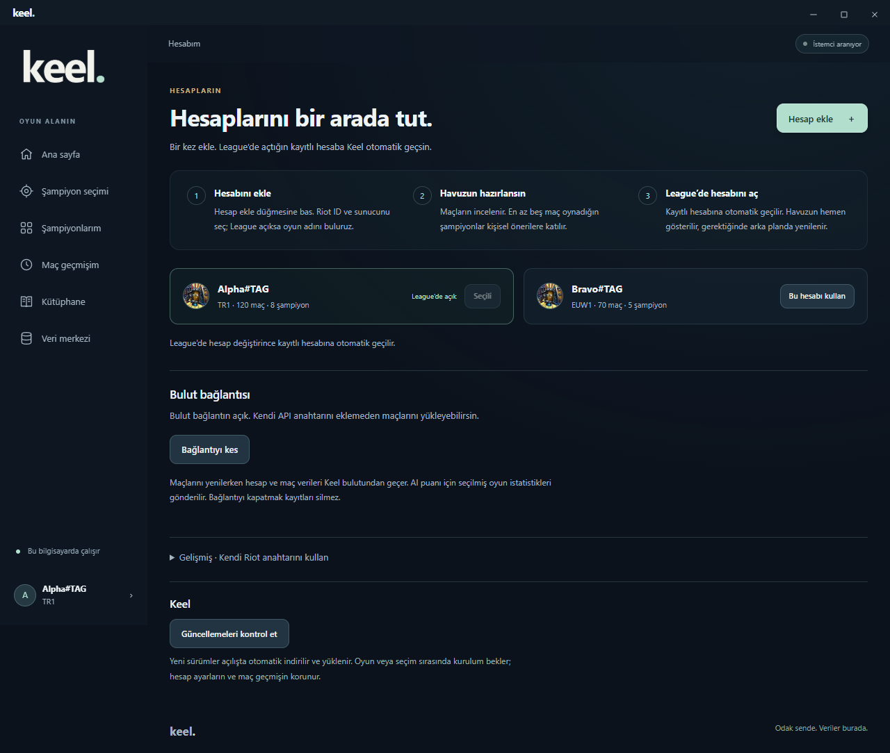

<p align="center">
  
</p>

<p align="center">
  <a href="https://github.com/kjtasan/keel-lol/releases/latest"></a>
</p>

<p align="center">
  <a href="#kurulum">Kurulum</a> · <a href="#hesap-ekleme-ve-bulut-bağlantısı">Hesaplar</a> · <a href="https://github.com/kjtasan/keel-lol/releases">Sürüm notları</a> · <a href="https://github.com/kjtasan/keel-lol/issues">Sorun bildir</a>
</p>

Keel, League of Legends için şampiyon önerileri, maç hazırlığı ve performans analizi sunan bir Windows uygulamasıdır. Takımını ve rakibini dikkate alan seçenekleri karşılaştırabilir, rün ve eşyalarını hazırlayabilir, maçtan sonra katkını ve gelişimini inceleyebilirsin.

## Her şey tek yerde

Ana sayfadan şampiyon seçimine, kişisel havuzuna, maç geçmişine ve kütüphaneye ulaş. League istemcisiyle bağlantı otomatik kurulur; seçim başlayınca ilgili ekran açılır.

<p align="center"></p>

*Güncel ana sayfa; sol alttaki hesap bilgisi temsili olarak gösterilmiştir.*

## Takımına ve rakibine göre altı seçenek

En iyi seçenek öne çıkar; diğer beş öneriyi aynı ekranda karşılaştırabilirsin. İki takımın seçimleri ve yasakları yanlarda yer alır. Koridor rakibi belli olduğunda eşleşme oranı, yeterli veri bulunduğunda takım arkadaşlarınla ikili sonuçlar gösterilir.

Sıralama yalnız en yüksek yüzdeyi seçmez. Eşleşme oranı, takım uyumu ve örnek desteği birlikte değerlendirilir; yakın oranlarda daha güçlü takım uyumu öne geçebilir. **3/4** gibi gösterimler, seçilmiş dört takım arkadaşından kaçının ikili verisinin bulunduğunu belirtir. Eksik veriden uyum veya oran üretilmez.

<p align="center"></p>

*Temsili seçim ekranı. Bu görseldeki oranlar, örnek sayıları ve sıralama arayüzü tanıtmak içindir; gerçek veya güncel eşleşme istatistiği olarak kullanılmamalıdır. İkili oranları tüm takımın kazanma ihtimali değildir.*

## Maçtaki katkını gör

Maç geçmişi; şampiyonunu, koridor rakibini, skorunu, rünlerini ve eşyalarını bir araya getirir. **Maç puanı**, rol ve moda göre uygun maç sonu ölçümlerinden bilgisayarında hesaplanır. Yalnız KDA’ya veya galibiyete dayanmaz; yeterli veri yoksa puan verilmez. **Neden?** ile gerekçeyi, **Maç analizi** ile katkılarını, karşılaştırmaları ve sonraki maç için somut hedefleri açabilirsin.

<p align="center"></p>

*İki maç da temsili verilerle hazırlanmıştır; gerçek bir hesabın geçmişi değildir. 8,9 ve 3,4 puanları, örnek istatistiklerden uygulamanın mevcut yerel yöntemiyle hesaplanmıştır. Puanlar oyun içindeki her kararı ölçmez.*

**Keel kapalıyken oynadığın maçlar da getirilebilir.** Geçmişi yenile düğmesi son 20 maçı getirir; daha eski maçlar 20’şer, son 200 maç kapsamında yüklenebilir. Onaylanmış bulut erişimi veya gelişmiş ayarlardaki kendi Riot anahtarın gerekir. Ayrıntılı yerel rapor ek AI kotası kullanmaz. İsteğe bağlı **AI yorumları** bulutta hazırlanır ve günlük kota kullanır; karttaki yerel maç puanından ayrıdır.

| Bölüm | Ne işe yarar? |
|---|---|
| **Şampiyon seçimi** | Rolüne, takımına ve rakibine göre altı seçeneği karşılaştırır. |
| **Maç hazırlığı** | Kilitlediğin şampiyon için rün, eşya, büyü ve dört bölümden oluşan kısa oyun planını gösterir. |
| **Sessiz mod** | Maç sırasında bildirimlerle bölmez; hazırladığın planı açıp inceleyebilirsin. |
| **Maç analizi** | Maçtaki katkını ve geliştirebileceğin noktaları gösterir; uygun geçmiş maçlarınla karşılaştırır. Akış analizi için geçerli canlı kayıt gerekir. |
| **Kütüphane** | Şampiyonları, dizilimleri, ikili sonuçları ve rakip eşleşmelerini bir araya getirir. |
| **Veri merkezi** | Kaynakları, yama bilgisini ve veri kapsamını gösterir; ortak verileri yeniler. |

<details>
<summary><strong>Kütüphaneyi incele</strong></summary>

Eşya, rün ve sihirdar büyüsü adlarında oyundaki Türkçe karşılıklar kullanılır. Ortak şampiyon, dizilim ve görsel verileri kurulumla hazır gelir.


</details>

> **0.1.16:** Altı öneri, takım uyumu, maça özel plan ve daha ayrıntılı maç değerlendirmesi. [Sürüm notları](https://github.com/kjtasan/keel-lol/releases/tag/v0.1.16).

## Kurulum

**Windows 10 (19041 ve sonrası) veya Windows 11 · 64 bit**

1. [Son sürümün kurulum dosyasını resmî Releases sayfasından indir.](https://github.com/kjtasan/keel-lol/releases/latest)
2. Dosyanın SHA-256 değerini sürüm notlarındaki değerle karşılaştır.
3. Windows SmartScreen “Windows bilgisayarınızı korudu” şeklinde **tanınmayan uygulama** uyarısı gösterirse, kaynağı ve dosya özetini doğruladıktan sonra **Ek bilgi → Yine de çalıştır** seçeneğini kullanabilirsin. Bu seçenek görünmüyorsa veya Windows bir tehdit/yönetici engeli bildiriyorsa korumaları kapatma.
4. Kurulumu tamamla ve masaüstü kısayolundan Keel’i aç.
5. League istemcisini aç. Şampiyon seçimi başlayınca Keel ilgili ekrana otomatik geçer.

Keel'in Windows yayıncı sertifikası henüz yoktur; bu yüzden SmartScreen uygulamayı tanımadığına dair uyarı gösterebilir. [Microsoft'un SmartScreen açıklaması](https://learn.microsoft.com/windows/apps/package-and-deploy/smartscreen-reputation).

<details>
<summary><strong>0.1.16 kurucusunun SHA-256 değerini denetle</strong></summary>

Dosya: `Keel-Setup-0.1.16.exe`

```text
9c29f1aad8cb53623d95d7121493907e489a6e327cec2543b0393a7434a1a459
```

PowerShell'de kurucunun bulunduğu klasörden:

```powershell
Get-FileHash .\Keel-Setup-0.1.16.exe -Algorithm SHA256
```

Çıktıdaki özet yukarıdakiyle eşleşmelidir. Diğer sürümlerde o sürümün notlarındaki değeri veya `SHA256SUMS.txt` dosyasını kullan. Özet kontrolü, dosyanın yayımlanan kopyayla aynı olduğunu gösterir; Windows yayıncı imzasının yerine geçmez.

</details>

Başlamak için Riot anahtarı eklemen, Python kurman veya komut satırı kullanman gerekmez. Görüntüleme bileşeni eksikse kurulum Microsoft WebView2’yi internet üzerinden hazırlar.

## Hesap ekleme ve bulut bağlantısı

**Kendi Riot API anahtarını alman gerekmez.** Keel, ilk açılışta kapalı test bağlantısını otomatik hazırlar; adres veya kod yazmazsın. Yeni bir test kurulumu, yönetici onayından sonra veri hizmetine erişebilir. Bu hizmet herkese açık, sınırsız erişim sunmaz; günlük kotalar geçerlidir.

**Hesabım → Hesap ekle** üzerinden Riot ID ve sunucunu seç. League açıksa oyun adını bulabiliriz; sunucunu ayrıca kontrol et. Birden fazla hesap saklayabilirsin. League'de kayıtlı hesabını açınca Keel ona geçer, kayıtlı havuzunu gösterir ve eksik/eski havuzu gerektiğinde arka planda yeniler. İlk ekleme bildirimi kısa süre görünür.



*Görsel örnek hesaplar içerir; gerçek kişisel hesap veya maç verisi değildir.*

**Bağlantıyı kes** ile bulutu tek düğmeyle kapatabilirsin. Tercihin sonraki açılışlarda korunur; tek düğmeyle yeniden açabilirsin. Kapatmak bilgisayarındaki hesapları/geçmişi veya bulut önbelleğini silmez. Genel öneriler, kütüphane ve yerel kayıtlar kullanılabilir.

Ortak Riot anahtarı Cloudflare hizmetinde gizli tutulur; uygulamaya ve kullanıcılara verilmez. Riot parolan istenmez. İstersen **Gelişmiş → Kendi Riot anahtarını kullan** seçeneği de vardır. Ayrıntılı veri akışı [gizlilik açıklamasındadır](docs/legal/PRIVACY.md).

## Güncellemeler ve verilerin

- **Uygulama kendini günceller.** 0.1.2 ve sonrasında Keel açılışta yeni sürümü arka planda kontrol eder, doğrular ve otomatik indirir. Kurulumu oyun, şampiyon seçimi ve veri işlemleri bittikten sonra yapar; ardından yeniden açılır.

- **Maç geçmişin korunur.** Kişisel havuzun, maç kayıtların ve ayarların program dosyalarından ayrı, kendi bilgisayarında tutulur. Yeni sürüm kurulurken silinmez.

- **Ortak veriler kurulumla gelir.** Şampiyon, görsel ve eşleşme verilerini kullanmak için kendi maç arşivini toplaman gerekmez. Oyun verilerini ayrıca **Veri merkezi** üzerinden yenileyebilirsin.

<details>

<summary><strong>İlk sürümler ve kurulum hakkında</strong></summary>

0.1.4 veya daha eski bir sürümde güncelleme denetimi “kontrol ediliyor” durumunda kalıyorsa [son kurulum dosyasını](https://github.com/kjtasan/keel-lol/releases/latest) bir kez indirip mevcut kurulumun üzerine yükle. 0.1.5, paketlenmiş uygulamadaki güvenli bağlantı dosyası eksikliğini düzeltir. Hesap ayarların ve maç kayıtların korunur; sonraki güncellemeleri Keel yönetir.

Windows yayıncı sertifikası henüz eklenmemiştir. Resmî dağıtım adresi bu deponun [Releases](https://github.com/kjtasan/keel-lol/releases) bölümüdür. Keel’in güncelleme sistemi sürüm bilgisinin imzasını ve indirilen kurulum dosyasının bütünlüğünü kontrol eder.

</details>

## Lisans ve kullanım

Keel'in mevcut ücretsiz sürümleri kişisel kullanıma açıktır; kaynak kodu kapalıdır. Gelir elde edilen yayın ve videolarda kullanım, ekran görüntüsü ve ekran kaydı paylaşımı serbesttir. Yazılımı satma, değiştirme, tersine mühendislik yapma veya kurucuyu başka yerde barındırıp yeniden dağıtma izni verilmez; kanunun zorunlu olarak tanıdığı haklar saklıdır. Ayrıntılar [kullanım koşulları](docs/legal/TERMS.md), [İngilizce koşullar](docs/legal/LICENSE.md) ve [kullanım özeti](docs/legal/USAGE.md) sayfalarındadır. Gelecekteki sürüm ve ek hizmetlerin ücretleri ayrıca belirlenebilir; geçmiş kullanım geriye dönük ücretlendirilmez.

## Gizlilik

Kişisel maç arşivin geliştiriciye otomatik bir kullanıcı raporu olarak gönderilmez. Bulut bağlantısında hesap/maç sorguları Keel'in Cloudflare hizmetinden geçer. Yerel kayıtlar, Cloudflare bulut bağlantısı ve AI değerlendirmesinin veri akışı [gizlilik açıklamasında](docs/legal/PRIVACY.md) anlatılır. AI modelinin istemine hesap kimlikleri eklenmez; buna rağmen AI sonuçları ve istatistik özet anahtarları bulutta kalıcı önbelleğe alınır ve mevcut kodda otomatik silme süresi yoktur. Bulut bağlantısını kaldırmak bu önbelleği otomatik silmez. Bu teknik açıklama, tamamlanmış bir KVKK aydınlatma metni olarak sunulmaz.

## İletişim

Destek, gizlilik ve kullanım izni soruları için **Discord: `kjtasan`** (özel mesaj) veya **[lysander.yedek@gmail.com](mailto:lysander.yedek@gmail.com)** üzerinden iletişime geçebilirsin. Kendin gönderdiğin mesaj ve ekler geliştiriciye ulaşır. Genel hataları [Issues](https://github.com/kjtasan/keel-lol/issues) üzerinden bildirebilirsin; API anahtarını, davet kodunu veya kişisel hesap bilgilerini herkese açık paylaşma.

## Son sürümün kapsamı

0.1.16, altı önerili şampiyon seçimini, takım arkadaşı başına uyum değerlendirmesini, maça özel planı ve yerel maç puanını getirir. [Kısa sürüm notları](https://github.com/kjtasan/keel-lol/releases/tag/v0.1.16).

---

Keel geliştirme aşamasındadır. Öneriler mevcut veriye dayanır; kazanma garantisi vermez. Görseller örnek hesap ve seçimlerle hazırlanmıştır.

Bu depo uygulama tanıtımını ve Windows kurulumlarını içerir. Kişisel veriler, Riot anahtarları ve ham maç arşivi yayımlanmaz.

Keel, Riot Games tarafından desteklenmez veya onaylanmaz. League of Legends ve ilgili oyun görselleri Riot Games’e aittir.
