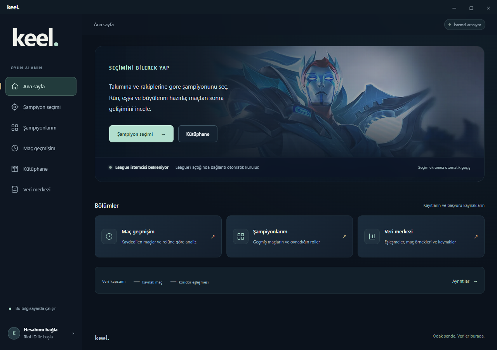

<p align="center">

  

</p>

<p align="center">

  <a href="https://github.com/kjtasan/keel-lol/releases/latest"></a>

</p>

<p align="center">

  <a href="#kurulum">Kurulum</a> · <a href="#hesap-ekleme-ve-bulut-bağlantısı">Hesaplar</a> · <a href="https://github.com/kjtasan/keel-lol/releases">Sürüm notları</a> · <a href="https://github.com/kjtasan/keel-lol/issues">Sorun bildir</a>

</p>

Keel, League of Legends için bir Windows yardımcısıdır. Takımına ve rakiplerine göre şampiyon seçeneklerini karşılaştır, rün ve eşyalarını hazırla. Maçtan sonra katkını incele, geçmişinle karşılaştır ve sonraki maç için somut hedefler belirle.

## Seçimler değiştikçe öneriler de değişir

Takımın ve karşı takım şampiyon seçtikçe Keel seçenekleri yeniden değerlendirir. Koridor rakibin netleştiğinde eşleşme verisini kullanır; henüz belli değilse kör seçim için uygun adayları değerlendirir. Her önerinin gerekçesini ve hangi noktalarda yeterli veri bulunmadığını görebilirsin.

<p align="center">

  

</p>

*Örnek seçim ekranı. Öneriler rolüne, seçimlere ve mevcut veriye göre değişir.*

## Maça hazırlan, sonrasında dönüp bak

Ortak şampiyon, rün ve eşya verileri kurulumla hazır gelir. Maç analizi, yerel kayıtların veya indirdiğin maç verileriyle hazırlanır; ayrıntılı raporu açmak ek AI kotası kullanmaz. Kişisel geçmiş ve AI puanı için gereken bağlantıyı [hesaplar bölümünde](#hesap-ekleme-ve-bulut-bağlantısı) bulabilirsin.

| Bölüm | Ne işe yarar? |
|---|---|
| **Şampiyon seçimi** | Rolünü, takımını ve rakiplerini dikkate alan seçenekler sunar. Seçim başlayınca ana sayfadan otomatik geçiş yapar. |
| **Maç hazırlığı** | Kilitlediğin şampiyon için rün, eşya ve sihirdar büyüsü seçeneklerini kısa bir koridor planıyla gösterir. |
| **Sessiz mod** | Oyun sırasında bildirimlerle bölmez. Hazırladığın planı ve eşya önerilerini açıp inceleyebilirsin. |
| **Kütüphane** | Şampiyonların yaygın rollerini, dizilimlerini, takım arkadaşlarıyla uyumunu ve rakip eşleşmelerini bir araya getirir. |
| **Maç analizi** | Maçtaki katkını, inceleyebileceğin noktaları ve sonraki maç için en fazla iki somut hedefi gösterir. Uygun geçmiş maçlarınla karşılaştırır; varsa canlı kaydınla gelişimini tamamlar. |
| **Veri merkezi** | Kullanılan kaynakları ve veri kapsamını gösterir; yama ve ortak eşleşme verilerini yenileyebilirsin. |

**Keel kapalıyken oynadığın maçlar da listelenir.** Maç geçmişim bölümündeki **Geçmişi yenile** düğmesi son 20 maçı getirir; daha eskileri 20’şer maç halinde, son 200 maç kapsamında yükleyebilirsin. Maç sonu skoru, eşyalar, hasar, görüş ve skora katkı bilgileri gösterilir. Varsa eşleşen Keel canlı analizi aynı karttan açılır. Bu özellik onaylanmış bulut erişimiyle veya gelişmiş ayarlardaki kendi Riot anahtarınla çalışır.

**Maç kartında rakibini ve hazırlığını da gör.** Yeşil çerçevede oynadığın şampiyon, kırmızı çerçevede koridor rakibin yer alır. Yanlarında mod, koridor, tarih, skor, büyü ve rün ikonları, eşyalar ve AI puanı gösterilir. İkonların adlarına üzerlerine gelerek ulaşabilirsin. Bulut erişimiyle 10 üzerinden AI puanı hazırlanır; “Neden?” ile kısa Türkçe gerekçesi açılır. Puan, rol ve maç sonu istatistiklerine dayalı yaklaşık bir yorumdur. Oyuncu adı, PUUID, maç kimliği ve Riot anahtarı modele gönderilmez. Puanlar saklanır; kapalı testte günlük değerlendirme sınırı vardır.

<p align="center"></p>

*Örnek geçmiş ekranı; gerçek hesabın verilerini içermez. Görseldeki puanlar yerleşimi göstermek için örnektir.*

Eşya, rün ve sihirdar büyüsü adlarında **oyundaki Türkçe karşılıklar** kullanılır. Eşya kütüphanesi Sihirdar Vadisi kapsamına göre süzülür.

<p align="center">

  

</p>

<details>

<summary><strong>Ana sayfayı da incele</strong></summary>

Ana sayfadan seçim ekranına, kütüphaneye, maç geçmişine ve veri merkezine geçebilirsin. League bağlantısı otomatik kurulur.



</details>

> **0.1.15 ile yenilendi:** Çoklu hesap, otomatik hesap/havuz geçişi, oyun içi profil simgesi, League rol simgeleri ve seçim sekmesinde yeşil parlama. [Sürüm notları.](https://github.com/kjtasan/keel-lol/releases/tag/v0.1.15)

## Kurulum

**Windows 10 (19041 ve sonrası) veya Windows 11 · 64 bit**

1. [Son sürümün kurulum dosyasını resmî Releases sayfasından indir.](https://github.com/kjtasan/keel-lol/releases/latest)
2. Dosyanın SHA-256 değerini sürüm notlarındaki değerle karşılaştır.
3. Windows SmartScreen “Windows bilgisayarınızı korudu” şeklinde **tanınmayan uygulama** uyarısı gösterirse, kaynağı ve dosya özetini doğruladıktan sonra **Ek bilgi → Yine de çalıştır** seçeneğini kullanabilirsin. Bu seçenek görünmüyorsa veya Windows bir tehdit/yönetici engeli bildiriyorsa korumaları kapatma.
4. Kurulumu tamamla ve masaüstü kısayolundan Keel’i aç.
5. League istemcisini aç. Şampiyon seçimi başlayınca Keel ilgili ekrana otomatik geçer.

Keel'in Windows yayıncı sertifikası henüz yoktur; bu yüzden SmartScreen uygulamayı tanımadığına dair uyarı gösterebilir. [Microsoft'un SmartScreen açıklaması](https://learn.microsoft.com/windows/apps/package-and-deploy/smartscreen-reputation).

<details>
<summary><strong>0.1.15 kurucusunun SHA-256 değerini denetle</strong></summary>

Dosya: `Keel-Setup-0.1.15.exe`

```text
9276b9f27ca3d73c85bf098706932bd438f8328a04a7f286f02da77a98e26750
```

PowerShell'de kurucunun bulunduğu klasörden:

```powershell
Get-FileHash .\Keel-Setup-0.1.15.exe -Algorithm SHA256
```

Çıktıdaki özet yukarıdakiyle eşleşmelidir. Diğer sürümlerde o sürümün notlarındaki değeri veya `SHA256SUMS.txt` dosyasını kullan. Özet kontrolü, dosyanın yayımlanan kopyayla aynı olduğunu gösterir; Windows yayıncı imzasının yerine geçmez.

</details>

Başlamak için Riot anahtarı eklemen, Python kurman veya komut satırı kullanman gerekmez. Görüntüleme bileşeni eksikse kurulum Microsoft WebView2’yi internet üzerinden hazırlar.

## Hesap ekleme ve bulut bağlantısı

**Kendi Riot API anahtarını alman gerekmez.** Keel, ilk açılışta kapalı test bağlantısını otomatik hazırlar; adres veya kod yazmazsın. Yeni bir test kurulumu, yönetici onayından sonra veri hizmetine erişebilir. Bu hizmet herkese açık, sınırsız erişim sunmaz; günlük kotalar geçerlidir.

**Hesabım → Hesap ekle** üzerinden Riot ID ve sunucunu seç. League açıksa oyun adını bulabiliriz; sunucunu ayrıca kontrol et. Birden fazla hesap saklayabilirsin. League'de kayıtlı hesabını açınca Keel ona geçer, kayıtlı havuzunu gösterir ve eksik/eski havuzu gerektiğinde arka planda yeniler. İlk ekleme bildirimi kısa süre görünür.


*Görsel örnek hesaplar içerir; gerçek kişisel hesap veya maç verisi değildir.*

**Bağlantıyı kes** ile bulutu tek düğmeyle kapatabilirsin. Tercihin sonraki açılışlarda korunur; tek düğmeyle yeniden açabilirsin. Kapatmak bilgisayarındaki hesapları/geçmişi veya bulut önbelleğini silmez. Genel öneriler, kütüphane ve yerel kayıtlar kullanılabilir.

Ortak Riot anahtarı Cloudflare hizmetinde gizli tutulur; uygulamaya ve kullanıcılara verilmez. Riot parolan istenmez. İstersen **Gelişmiş → Kendi Riot anahtarını kullan** seçeneği de vardır. Ayrıntılı veri akışı [gizlilik açıklamasındadır](docs/legal/PRIVACY.md).

## Güncellemeler ve verilerin

- **Uygulama kendini günceller.** 0.1.2 ve sonrasında Keel açılışta yeni sürümü arka planda kontrol eder, doğrular ve otomatik indirir. Kurulumu oyun, şampiyon seçimi ve veri işlemleri bittikten sonra yapar; ardından yeniden açılır.

- **Maç geçmişin korunur.** Kişisel havuzun, maç kayıtların ve ayarların program dosyalarından ayrı, kendi bilgisayarında tutulur. Yeni sürüm kurulurken silinmez.

- **Ortak veriler kurulumla gelir.** Şampiyon, görsel ve eşleşme verilerini kullanmak için kendi maç arşivini toplaman gerekmez. Oyun verilerini ayrıca **Veri merkezi** üzerinden yenileyebilirsin.

<details>

<summary><strong>İlk sürümler ve kurulum hakkında</strong></summary>

0.1.4 veya daha eski bir sürümde güncelleme denetimi “kontrol ediliyor” durumunda kalıyorsa [son kurulum dosyasını](https://github.com/kjtasan/keel-lol/releases/latest) bir kez indirip mevcut kurulumun üzerine yükle. 0.1.5, paketlenmiş uygulamadaki güvenli bağlantı dosyası eksikliğini düzeltir. Hesap ayarların ve maç kayıtların korunur; sonraki güncellemeleri Keel yönetir.

Windows yayıncı sertifikası henüz eklenmemiştir. Resmî dağıtım adresi bu deponun [Releases](https://github.com/kjtasan/keel-lol/releases) bölümüdür. Keel’in güncelleme sistemi sürüm bilgisinin imzasını ve indirilen kurulum dosyasının bütünlüğünü kontrol eder.

</details>

## Lisans ve kullanım

Keel'in mevcut ücretsiz sürümleri kişisel kullanıma açıktır; kaynak kodu kapalıdır. Gelir elde edilen yayın ve videolarda kullanım, ekran görüntüsü ve ekran kaydı paylaşımı serbesttir. Yazılımı satma, değiştirme, tersine mühendislik yapma veya kurucuyu başka yerde barındırıp yeniden dağıtma izni verilmez; kanunun zorunlu olarak tanıdığı haklar saklıdır. Ayrıntılar [kullanım koşulları](docs/legal/TERMS.md), [İngilizce koşullar](docs/legal/LICENSE.md) ve [kullanım özeti](docs/legal/USAGE.md) sayfalarındadır. Gelecekteki sürüm ve ek hizmetlerin ücretleri ayrıca belirlenebilir; geçmiş kullanım geriye dönük ücretlendirilmez.

## Gizlilik

Kişisel maç arşivin geliştiriciye otomatik bir kullanıcı raporu olarak gönderilmez. Bulut bağlantısında hesap/maç sorguları Keel'in Cloudflare hizmetinden geçer. Yerel kayıtlar, Cloudflare bulut bağlantısı ve AI değerlendirmesinin veri akışı [gizlilik açıklamasında](docs/legal/PRIVACY.md) anlatılır. AI modelinin istemine hesap kimlikleri eklenmez; buna rağmen AI sonuçları ve istatistik özet anahtarları bulutta kalıcı önbelleğe alınır ve mevcut kodda otomatik silme süresi yoktur. Bulut bağlantısını kaldırmak bu önbelleği otomatik silmez. Bu teknik açıklama, tamamlanmış bir KVKK aydınlatma metni olarak sunulmaz.

## İletişim

Destek, gizlilik ve kullanım izni soruları için **Discord: `kjtasan`** (özel mesaj) veya **[lysander.yedek@gmail.com](mailto:lysander.yedek@gmail.com)** üzerinden iletişime geçebilirsin. Kendin gönderdiğin mesaj ve ekler geliştiriciye ulaşır. Genel hataları [Issues](https://github.com/kjtasan/keel-lol/issues) üzerinden bildirebilirsin; API anahtarını, davet kodunu veya kişisel hesap bilgilerini herkese açık paylaşma.

## Son sürümün kapsamı

0.1.15 hesap yönetimi, otomatik bağlantı ve arayüzü yeniler. Şampiyon önerilerini sıralama yöntemi ve ortak oyun verileri bu sürümde değiştirilmedi. [Kısa sürüm notları](https://github.com/kjtasan/keel-lol/releases/tag/v0.1.15).

---

Keel geliştirme aşamasındadır. Öneriler mevcut veriye dayanır; kazanma garantisi vermez. Görseller örnek hesap ve seçimlerle hazırlanmıştır.

Bu depo uygulama tanıtımını ve Windows kurulumlarını içerir. Kişisel veriler, Riot anahtarları ve ham maç arşivi yayımlanmaz.

Keel, Riot Games tarafından desteklenmez veya onaylanmaz. League of Legends ve ilgili oyun görselleri Riot Games’e aittir.
